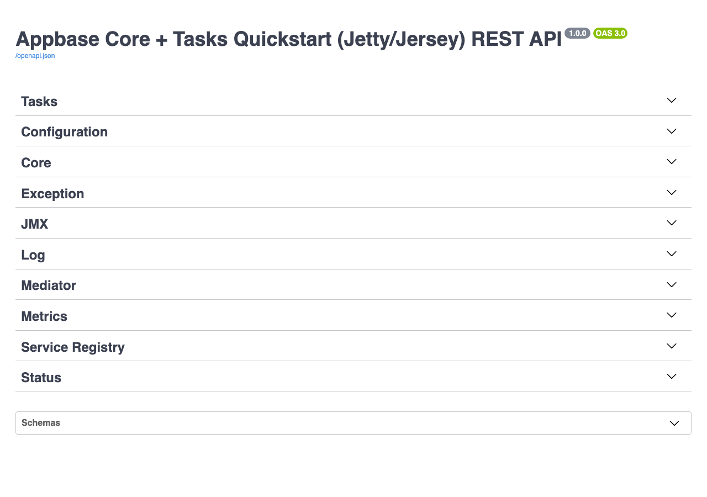

<picture>
  <source media="(prefers-color-scheme: dark)" srcset="docs/branding/lockup-dark.svg">
  
</picture>

# Appbase

[](https://central.sonatype.com/artifact/com.viveworks.appbase/appbase-core)

**A modular Java 25 framework for building backend services: core runtime services, backend
adapters, application services, and a choice of embedded server, assembled from one or more YAML
configurations.**

**Contents:** [What is Appbase](#what-is-appbase) · [Capabilities](#capabilities) ·
[Release 1 support](#release-1-support) · [Quick start](#quick-start)
([Reactor Netty example](#1-reactor-netty-embedded-jpa--h2),
[Jetty + Jersey example](#2-embedded-jetty--jersey-embedded-jpa--h2)) ·
[Swagger UI](#swagger-ui) ([Reactor Netty](#reactor-netty-example),
[Jetty + Jersey](#jetty--jersey-example)) · [Documentation](#documentation) ·
[Artifacts](#artifacts) · [Appbase Core REST Endpoints](#appbase-core-rest-endpoints) ·
[What comes next](#what-comes-next) · [License](#license)

## What is Appbase

Appbase is a set of Maven modules that you combine into a service.

The core modules supply the runtime a service needs: logging, metrics, validation, configuration,
a service registry, tracing, JMX and an internal mediator.

Adapter modules connect that runtime to data stores, messaging and identity providers.

Service modules add ready-made application features: user accounts, sessions, OAuth/OIDC sign-in,
and web endpoints.

A bootstrap module then runs everything on the embedded server you choose.

This README gives an overview of Release 1.0.0. Every supported module and artifact is described in
the shipped [catalogue](#documentation), including the release's [known limitations](docs/Known-Limitations.md).

## Capabilities

| Capability | What it gives you | Where to look |
|---|---|---|
| **Core services** | - Log, Metric, Tracing, JMX services<br>- Exception, Configuration, Service Registry<br>- Reactive, YAML / JSON, Lucene utilities | `appbase-core`, `appbase-bootstrap-core` |
| **Backend adapters** | Clients for caching, datastores, object stores, messaging, search and identity backends.<br><br>For example, Aerospike, Cassandra, S3, Druid, Elasticsearch, JPA, Kafka, R2DBC, Redis. | `appbase-client-*` |
| **Application services** | User accounts and sessions, web endpoints, and OAuth/OIDC sign-in with a token cache | `appbase-service-*` |
| **Server bootstrap** | Run on embedded Jetty, Tomcat or Undertow (servlet), or on Reactor Netty (reactive) | `appbase-bootstrap-*` |
| **Configuration wizard** | Generates a valid YAML configuration file, from the console or a web UI | `appbase-config-wizard` |
| **BOM** | One import that pins every Release 1 artifact to the same version. Deferred modules are left out | `appbase-bom` |
| **Stacktest** | A representative end-to-end test of a running Appbase stack, and the reference bootstrap | `appbase-stacktest` |

## Release 1 support

<!-- release-evidence:begin -->
<!-- release-evidence:end -->

## Quick start

Appbase 1.0.0 is published on Maven Central. Add the released coordinate directly:

```xml
<dependency>
  <groupId>com.viveworks.appbase</groupId>
  <artifactId>appbase-core</artifactId>
  <version>1.0.0</version>
</dependency>
```

Next, generate a configuration file with `appbase-config-wizard/bin/start-console.sh` and read
[Configuration reference](docs/Configuration-Reference.md). Whether each of these steps has actually
been run is recorded in [Examples](docs/Examples.md). All seven local examples have been EXECUTED: six
on JDK 25, plus the minimum-JDK refusal example against an unsupported older toolchain. Examples that
need Docker, a backend or external infrastructure are NOT MEASURED.

Two full-stack quick-starters are minimal external consumer projects under [`examples/`](examples/),
each depending only on the published `1.0.0` coordinate above and starting a real service backed by
embedded JPA + H2, under a different embedded-server choice.

### 1. Reactor Netty (embedded JPA + H2)

[`examples/tasks-quickstart-reactor-netty/`](examples/tasks-quickstart-reactor-netty/) registers a
Tasks REST resource on `AppbaseRouteRegistry` and starts a real `ReactorNettyAppbaseWebServer`.
Real API usage, pulled directly from
[`TasksEndpoint.java`](examples/tasks-quickstart-reactor-netty/src/main/java/com/viveworks/appbase/example/reactornetty/TasksEndpoint.java):

```java
registry.route("GET", COLLECTION_PATH, exchange -> Mono.fromCallable(() ->
                withEntityManager(entityManagerFactory, em -> em
                        .createQuery("select t from Task t order by t.id", Task.class)
                        .getResultList()))
        .subscribeOn(Schedulers.boundedElastic())
        .flatMap(tasks -> exchange.writeJson(tasks.stream().map(TasksEndpoint::taskBody).toList())));
```

This minimal example configures Appbase programmatically rather than from a YAML file -- it starts
only the Reactor Netty web server (`ReactorNettyAppbaseWebServer`), not the full `AppbaseCore`/Guice
service stack a YAML configuration assembles. A real YAML-configured service, generated by the
configuration wizard, is demonstrated end to end by `appbase-stacktest` (see
[Configuration reference](docs/Configuration-Reference.md)).

<details>
<summary>How this example builds and starts the server (click to show)</summary>

```java
final AppbaseRouteRegistry registry = new AppbaseRouteRegistry();
TasksEndpoint.register(registry, entityManagerFactory, new ObjectMapper());

final ReactorNettyAppbaseWebServer server = new ReactorNettyAppbaseWebServer(
        ReactorNettyAppbaseWebServerConfiguration.builder().host("127.0.0.1").port(0).build(),
        registry,
        List.of(),
        new ObjectMapper());
server.start();
```

</details>

### 2. Embedded Jetty + Jersey (embedded JPA + H2)

[`examples/tasks-quickstart-jetty-jersey/`](examples/tasks-quickstart-jetty-jersey/) registers the
same Tasks resource/service pattern as a real JAX-RS resource on embedded Jetty + Jersey instead.
Real API usage, pulled directly from
[`TasksResource.java`](examples/tasks-quickstart-jetty-jersey/src/main/java/com/viveworks/appbase/example/jettyjersey/TasksResource.java):

```java
@POST
public Response create(final Map<String, Object> request) {
    final String title = String.valueOf(request.get("title"));
    final Task created = withEntityManager(em -> {
        final Task task = new Task(title);
        em.persist(task);
        return task;
    });
    return Response.status(Response.Status.CREATED).entity(taskBody(created)).build();
}
```

Like the Reactor Netty example, this is configured programmatically, not from a YAML file.

<details>
<summary>How this example builds and starts the server (click to show)</summary>

```java
final AppbaseCoreServices coreServices = AppbaseCoreServices.builder().from(coreConfig).build();
final AppbaseServices appbaseServices = AppbaseServices.builder().from(coreServices).build();

final ResourceConfig resourceConfig = new ResourceConfig();
resourceConfig.register(new TasksResource(entityManagerFactory));
resourceConfig.register(JacksonFeature.class);

final JettyServletContainer server = JettyServletContainer.builder()
        .from(appbaseServices)
        .port(0)
        .resourceConfig(resourceConfig)
        .build();
server.start();
```

`coreConfig` builds the nine mandatory core-service sub-configurations (see the file linked above
for the full, real listing).

</details>

> **NOTE:** The servlet bootstraps use Jersey 3.1.11, whose embedded ASM supports
> `ResourceConfig.packages(...)` scanning on JDK 25.
>
> On a later Java runtime, Jetty, Tomcat, and Undertow fail fast before startup when package
> scanning is configured; register resource classes explicitly with `ResourceConfig.register(Class)`,
> run on a supported Java runtime, or upgrade Appbase/Jersey.
>
> The failure identifies the running Java N: “Jersey package scanning is supported through Java 25,
> but this server is running on Java N.” If Appbase cannot inspect a future Jersey layout safely, it
> fails closed with the same remedies instead of starting with unverified scanning.

## Swagger UI

Swagger UI is **opt-in and meant for development**. A Jetty service serves it only if it calls
`withSwaggerUI(...)` on its container builder. It is a separate static-file handler that sits
outside the servlet context, so the Appbase service filters, authentication included, do not cover
it. Do not turn it on for a service that is reachable from outside.

When a Jetty/Jersey-bootstrapped service also enables Core's OpenAPI document generation, you see
the REST APIs Core itself supports (configuration, log, metrics, and more -- the full real list is
in [Appbase Core REST Endpoints](#appbase-core-rest-endpoints)), and your own application's REST
API shows up alongside Core's on the same Swagger UI. Both screenshots below are real captures of a
real running service, using the real `org.webjars:swagger-ui` artifact `appbase-core` already
depends on.

### Jetty + Jersey example

[`examples/tasks-quickstart-jetty-jersey/`](examples/tasks-quickstart-jetty-jersey/) enables
`withAppbaseCoreServlets()` (Core's real, live management endpoints) alongside its own live
`TasksResource`, and serves one combined OpenAPI document covering both -- real, not fabricated: a
real headless-Chrome screenshot of that running service's Swagger UI, tagged by category so every
endpoint group is visible in one view: the example's own Tasks endpoints, plus Core's full real
REST surface (Configuration, Core, Exception, JMX, Log, Mediator, Metrics, Service Registry,
Status):



### Reactor Netty example

`appbase-bootstrap-reactor-netty` does not currently implement OpenAPI/Swagger-UI support (that is
a servlet-bootstrap-only capability today -- see `appbase-bootstrap-servlet`'s
`AppbaseCoreOpenApiRegistrar` and `JettyServletContainer.Builder#withSwaggerUI`, which have no
Reactor Netty equivalent). There is no Swagger UI screenshot for
[`examples/tasks-quickstart-reactor-netty/`](examples/tasks-quickstart-reactor-netty/) for that
reason; adding one would mean
adding real OpenAPI/Swagger support to the Reactor Netty bootstrap itself, which is out of scope for
this examples/docs change.

## Documentation

| Document | What it covers |
|---|---|
| [Module and Service Catalog](docs/Module-and-Service-Catalog.md) | Every shipped module and artifact: purpose, entry points, configuration, support state and limitations. This is the completeness authority |
| [User Guide](docs/user-guide/README.md) | Installation, a first service, the configuration wizard and deployment, tested on a clean machine |
| [Developer MCP](docs/developer-mcp.md) | Give Claude Code, Codex CLI, Cursor, or GitHub Copilot source-derived Appbase API and convention lookup |
| [Examples](docs/Examples.md) | Supported examples, each marked EXECUTED or NOT MEASURED |
| [Configuration reference](docs/Configuration-Reference.md) | How a service finds and reads its YAML, the override keys, server choice and test switches |
| [Known limitations](docs/Known-Limitations.md) | Interim Release 1 limitations; publication adds the generated release-specific view |
| API documentation | Supported public Java and Dart APIs. Not published yet |
| [Release notes](https://github.com/viveworks/Appbase/releases/tag/1.0.0) | What 1.0.0 contains and what is deferred to Release 2 |

## Artifacts

Published to Maven Central; the latest released version is 1.0.0.

<!-- api-inventory:supported-public:begin -->
| Supported public artifact | Family |
|---|---|
| `com.viveworks.appbase:appbase-bom` | build |
| `com.viveworks.appbase:appbase-bootstrap-core` | bootstrap |
| `com.viveworks.appbase:appbase-bootstrap-reactor-netty` | bootstrap |
| `com.viveworks.appbase:appbase-bootstrap-servlet` | bootstrap |
| `com.viveworks.appbase:appbase-bootstrap-servlet-jetty` | bootstrap |
| `com.viveworks.appbase:appbase-bootstrap-servlet-tomcat` | bootstrap |
| `com.viveworks.appbase:appbase-bootstrap-servlet-undertow` | bootstrap |
| `com.viveworks.appbase:appbase-client-aerospike` | client |
| `com.viveworks.appbase:appbase-client-cassandra` | client |
| `com.viveworks.appbase:appbase-client-cloud-aws-common` | client |
| `com.viveworks.appbase:appbase-client-cloud-aws-httpclient` | client |
| `com.viveworks.appbase:appbase-client-cloud-aws-s3` | client |
| `com.viveworks.appbase:appbase-client-core` | client |
| `com.viveworks.appbase:appbase-client-druid` | client |
| `com.viveworks.appbase:appbase-client-elasticsearch` | client |
| `com.viveworks.appbase:appbase-client-firebase` | client |
| `com.viveworks.appbase:appbase-client-jdbc` | client |
| `com.viveworks.appbase:appbase-client-jdbi` | client |
| `com.viveworks.appbase:appbase-client-jpa` | client |
| `com.viveworks.appbase:appbase-client-kafka` | client |
| `com.viveworks.appbase:appbase-client-r2dbc` | client |
| `com.viveworks.appbase:appbase-client-redis` | client |
| `com.viveworks.appbase:appbase-client-vitess` | client |
| `com.viveworks.appbase:appbase-client-zookeeper` | client |
| `com.viveworks.appbase:appbase-config-wizard` | tool |
| `com.viveworks.appbase:appbase-core` | core |
| `com.viveworks.appbase:appbase-service-core` | service |
| `com.viveworks.appbase:appbase-service-supportmessage` | service |
| `com.viveworks.appbase:appbase-service-user` | service |
| `com.viveworks.appbase:appbase-service-user-account-firebaseauth` | service |
| `com.viveworks.appbase:appbase-service-user-account-jdbi` | service |
| `com.viveworks.appbase:appbase-service-user-session-aerospike` | service |
| `com.viveworks.appbase:appbase-service-web` | service |
| `com.viveworks.appbase:appbase-service-web-oauth` | service |
| `com.viveworks.appbase:appbase-service-web-oauth-apple` | service |
| `com.viveworks.appbase:appbase-service-web-oauth-github` | service |
| `com.viveworks.appbase:appbase-service-web-oauth-google` | service |
| `com.viveworks.appbase:appbase-service-web-oauth-microsoft` | service |
| `com.viveworks.appbase:appbase-service-web-oauth-okta` | service |
| `com.viveworks.appbase:appbase-service-web-oauth-reactive` | service |
| `com.viveworks.appbase:appbase-service-web-oauth-tokencache-aerospike` | service |
| `com.viveworks.appbase:appbase-service-web-oauth-tokencache-redis` | service |
<!-- api-inventory:supported-public:end -->

## Appbase Core REST Endpoints

Appbase Core's own REST surface, served under `/appbase-core/restapi/v1` when a servlet bootstrap
enables `withAppbaseCoreServlets()`. Source of truth:
[`AppbaseServiceConstants.java`](appbase-java/appbase-service/appbase-service-core/src/main/java/com/viveworks/appbase/service/AppbaseServiceConstants.java).

| Category | Endpoint(s) |
|---|---|
| Configuration | `/appbase-core/restapi/v1/configurations` |
| Core | `/appbase-core/restapi/v1/core` |
| Exception | `/appbase-core/restapi/v1/exceptions` |
| JMX | `/appbase-core/restapi/v1/jmx` |
| Log | `/appbase-core/restapi/v1/logs` |
| Mediator | `/appbase-core/restapi/v1/mediator` |
| Metrics | `/appbase-core/restapi/v1/metrics` |
| Service Registry | `/appbase-core/restapi/v1/serviceRegistries` |
| Status | `/appbase-core/restapi/v1/status` |

Application-service endpoints (user accounts, health checks, support messages) are served under the
separate `/appbase-service/restapi/v1` prefix and depend on which service modules the application
assembles.

## What comes next

Release 2 work, including deferred adapter breadth, is tracked in the Release 2 Plan of
Record. The [1.0.0 release notes](https://github.com/viveworks/Appbase/releases/tag/1.0.0) record
the durable next-release decisions; this README does not copy that content.

## License

Apache License 2.0. See [`LICENSE`](LICENSE).

---

## Developing Appbase (contributors)

The rest of this README is for people working **on** Appbase, not with it.

## Building from source

Install the canonical [build prerequisites](docs/Configuration-Reference.md#build-prerequisites):
**JDK 25 or later, Maven 3.6.3 or later, git, Python 3 available as `python3`, ripgrep available as
`rg`, and bash**. Docker is needed only for backend integration tests.

Python 3 and ripgrep are needed only for building Appbase itself from source -- the API-inventory
self-check they drive (`scripts/api-inventory-fast-check.sh`) runs from `build.sh`, the repository's
own pre-push hook, and CI, none of which a Maven consumer of the published artifacts ever runs. A
service that only depends on `com.viveworks.appbase:*` coordinates via Maven does not need either
tool.

```sh
git clone https://github.com/viveworks/Appbase.git && cd Appbase
./build.sh --mode compile            # whole-repo compile, no tests; refuses on a JDK older than 25
mvn test -pl appbase-stacktest -am \
  -Dappbase-stacktest.skipTests=false \
  -Dtest=ReactiveShowcaseStackTest \
  -Dsurefire.failIfNoSpecifiedTests=false   # starts a real Reactor Netty service; no Docker needed
```

If `rg` is missing, use the [ripgrep installation guide](https://github.com/BurntSushi/ripgrep#installation),
or install it with `brew install ripgrep` on macOS, `sudo apt install ripgrep` on Debian/Ubuntu, or
`winget install BurntSushi.ripgrep.MSVC` on Windows. Confirm the command name with `rg --version`.

### API inventory gate

Run `bash scripts/api-inventory-fast-check.sh` to check generated API-inventory drift and this README consumer region. The same fast, fail-closed check runs from `build.sh`, the pre-push hook, and CI. The full inventory harness remains in CI and the leaf's own test harness.

The pre-push caller is a fast blocking convenience over the **current checkout only**; it does not
claim to bind evidence to each pushed ref. CI is the exact-commit authority: its checkout uses
`VERIFY_REF`, and the summary records the tested SHA.

- **Contributing** — Start with the public [contributor guide](CONTRIBUTING.md) for setup,
  checks, sign-off, licence expectations, review and merge, troubleshooting, and private
  security reports.

## Release 1.0.0 Stats

Measured against `develop`'s actual release-candidate tree and git history, not estimated.

- **Time to release:** 7 years, 9 months, 14 days (2,844 days) — first commit `2019-02-12` to
  `2026-11-26`.
- **Commits:** 2,806 on `develop`, from a single author across 3 git identities used over the
  project's life (`Navaneeth Mysore G`, `navaneeth-mysore-dev`, `navaneeth-mysore`).
- **Maven modules:** 55.
- **Lines of code:** 399,186 total (code lines only, via `cloc`, 3,698 files).
- **Tests:** 2,709 total.
  - Unit tests: 2,585
  - Integration tests: 93
  - Stacktests (`appbase-stacktest`, full-stack scenario coverage): 31
- **Full release-profile build** (`clean install site site:stage`, every module, every test
  tier): ~5h01m, last proven clean end to end on the exact commit this release ships.
