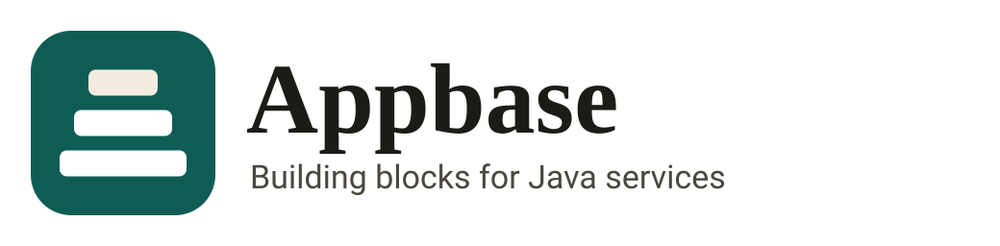

# Placeholder brand set — Release 1

> **This is a placeholder.** It gives Release-1 documentation and the public repository one
> clean, consistent look. It is **not** a final brand. It makes **no trademark, ownership or
> marketing claim**. The name, the mark and publication approval are decided at the owner
> checkpoint **internal work item 1940**, together with the name threads internal work item 1139 (`appbase.io`) and internal work item 1143 (the
> `com.viveworks` fallback). Everything below is built so a decision there costs one edit and one
> re-export, never a redesign.

Issue: internal work item 1415 (plan task N02 of epic internal work item 1142).

## What is here

| File | What it is | Editable source? |
|---|---|---|
| `icon.svg` | The icon: three stacked blocks on a rounded Viveworks teal tile, 512×512. It has **no letterform**, so it survives a rename. | yes — the source |
| `lockup-light.svg` | Icon + wordmark + tagline, for **light** backgrounds. Transparent. | yes |
| `lockup-dark.svg` | The same lockup, for **dark** backgrounds. Transparent. | yes |
| `palette.json` | The palette, the contrast pairs checked, and the 32 px legibility probes. | yes |
| `exports/icon-{32,64,128,256,512}.png` | The icon rendered at each canonical size, each directly from the SVG. | no — generated by `export.py` |
| `export.py` | Regenerates the five PNGs from `icon.svg`. | tool |
| `validate.py` | The checked-in gate: file set, sources, per-size exports, palette consistency, contrast, small-size legibility, claims. | tool |

**Wordmark:** `Appbase`, set as live SVG text. **Tagline:** *Building blocks for Java services* —
a plain description of what the project is, not a claim.

### Palette

| Role | Hex | Used for |
|---|---|---|
| `tile` | `#0F5C56` | icon background; the Viveworks brand accent |
| `glyph` | `#FFFFFF` | the two lower blocks |
| `accent` | `#F2EDE0` | the top block; selected from the documented dark ink because it clears the icon's 4.5 minimum |
| `ink-light` / `muted-light` | `#1B1B18` / `#4A4740` | Viveworks wordmark / tagline on light backgrounds |
| `ink-dark` / `muted-dark` | `#F2EDE0` / `#B3ADA0` | Viveworks wordmark / tagline on dark backgrounds |
| `page-light` / `raised-light` | `#FAF8F3` / `#FFFFFF` | Viveworks light background / raised surface |
| `page-dark` / `raised-dark` | `#1A1918` / `#232120` | Viveworks dark background / raised surface |
| `rule-light` / `rule-dark` | `#DDD6C4` / `#38352F` | Viveworks 1 px rules / borders |
| `brand-accent` / `accent-text-dark` | `#0F5C56` / `#38BAA0` | Viveworks accent; the brighter value is dark small-text/focus treatment |

The theme values above are the pinned Viveworks visual-system baseline from Thrivables internal work item 1737 §A.4
(planned in internal work item 1738) and the live `viveworks.com/assets/css/main.css`. The live stylesheet uses
`#FAF8F3` for the light background; `#F2EDE0` is its dark primary ink, not its light background.
The icon geometry is unchanged and remains name-independent, but its fills now use the Viveworks
system. The suggested bright teal `#38BAA0` measures only 3.24:1 against the `#0F5C56` tile, below the
retained 4.5 minimum; documented dark ink `#F2EDE0` measures 6.69:1 and is used for the top block.
On an actual dark Viveworks surface the icon still needs the light backing specified below.

## Accessibility — what is checked, and the measured result

`validate.py --only contrast` and `--only small` check these. The numbers are WCAG 2.x contrast ratios.

| Pair | Minimum | Measured |
|---|---|---|
| white block on teal tile | 4.5 | 7.82 |
| cream accent block on teal tile | 4.5 | 6.69 |
| teal tile on the actual light page (icon edge, WCAG 1.4.11) | 3.0 | 7.37 |
| light icon backing on actual dark page / raised surface (outer edge) | 3.0 | 16.54 / 15.11 |
| wordmark / tagline, light lockup on `#FAF8F3` | 4.5 | 16.26 / 8.73 |
| wordmark / tagline, dark lockup on `#1A1918` | 4.5 | 15.02 / 7.86 |

The blocks inside the icon are held to the **text** minimum (4.5), not the graphics minimum (3.0),
because at 32 px they are the only thing that identifies the mark.

**Small sizes.** The blocks are 72 units tall with 40-unit gaps on a 512 grid, so at 32 px each block is
4.5 px tall and each gap is 2.5 px. `validate.py --only small` reads six probe pixels from the real
32 px export: tile, accent block, gap, middle block, gap, base block. Each must be its exact palette
colour, and each must keep ≥ 4.5:1 against its neighbour. A layer that blurred into the tile at 32 px
would fail this check. **Below 32 px** (a 16 px favicon, for example) the gaps are just over 1 px. That
size is not a canonical export and is not claimed to be legible.

The lockups carry a `<title>`. Where a lockup or icon is placed in Markdown, give it alt text naming the
project (for example `alt="Appbase"`), not describing the shapes.

## Light and dark usage

Use the lockup that matches the background, never one lockup for both. On GitHub, choose by theme with
`prefers-color-scheme`:

```html
<picture>
  <source media="(prefers-color-scheme: dark)" srcset="lockup-dark.svg">
  
</picture>
```

The icon geometry is unchanged, but its placement differs by surface. On `#FAF8F3` light pages the tile
may sit directly on the page. On `#1A1918` dark pages or `#232120` dark raised surfaces, place the icon
on a `#FAF8F3` backing with at least 8 px padding at a 192 px rendered-mark size (a 1:24 minimum inset),
and a corner radius following the icon silhouette. The dark lockup implements that backing as
`<rect id="icon-backing">`. For a standalone PNG/SVG, the owning surface must supply the same backing;
do not place the teal tile directly on either dark surface. The validator checks the real two-edge
placement: teal tile → light backing, then light backing → each actual dark surface.

The lockups follow the Viveworks type roles: the wordmark uses the editorial-serif stack (`ui-serif`,
`Georgia`, `Iowan Old Style`, `Times New Roman`, `serif`) at weight 600; the tagline uses the system
sans stack (`system-ui`, `-apple-system`, `Segoe UI`, `Roboto`, `sans-serif`) at weight 400. The exact
letter shapes can therefore vary by platform. That is the price of a text-swappable wordmark.
Outlining the text to paths is a final-brand step, deferred with the rest of it (see *Scope*).

## Where it goes — placements, handed to the tasks that own those files

This task edits only `docs/branding/`. The placements below are **for the owning tasks to apply**. They
are listed here so every surface uses the same asset the same way.

| Surface | Owner | Asset | How |
|---|---|---|---|
| Root `README.md`, first element | internal work item 1415 | `lockup-light.svg` / `lockup-dark.svg` | wired by this task with the `<picture>` block above, width 520, `alt="Appbase"`; no other logo on the page |
| User Guide, title | internal work item 1416 | `exports/icon-64.png` | inline before the guide title, `alt=""` (decorative next to the written title), height 64; on a dark surface use the required light backing and proportional padding above |
| Existing Javadoc overview | internal work item 1415 | `lockup-light.svg` / `lockup-dark.svg` | wired in `appbase-java/javadoc-overview.html` with the same theme-aware `<picture>` block; future generator-owned header/favicon integration remains a internal work item 1141 replacement point |
| Public repository (social preview, organisation avatar) | internal work item 1009 (public export) | `exports/icon-512.png` | uploaded in the GitHub console. If the surrounding surface is dark, compose it on the required light backing first. Record the applied console settings with the release evidence. |
| Maven Site landing page | internal work item 1418 (Release 2) | `icon.svg` | deferred with the site itself |

## Replacing the placeholder — the swap points

Each replaceable thing has exactly one home. After any edit, re-export (if the icon changed) and
validate.

| To change | Edit | Then |
|---|---|---|
| **the name** | the text of `<text id="wordmark">` in both `lockup-light.svg` and `lockup-dark.svg` | validate. Widen the SVG `width`/`viewBox` if a longer name clips. No PNG depends on the name. |
| **the tagline** | the text of `<text id="tagline">` in both lockups | validate |
| **the mark** | the shapes inside `<g id="mark">` in `icon.svg`, then copy that group **unchanged** into both lockups | `export.py`, then validate (it fails if a lockup's mark differs from the icon's) |
| **a colour** | `palette.json` `colors`, and the same hex in the SVGs | `export.py`, then validate (it fails on any SVG colour not in `palette.json`, and on any pair below its minimum) |
| **a file name or set** | `EXPECTED_FILES` and `SVGS` in `validate.py`; for icon/export names also update the `exports/icon-{size}.png` paths in `validate.py` and `export.py` | validate; update the placements table and command examples above, then tell the owners |

### Re-export and validate

```sh
pip install resvg-py==0.5.0                # the pinned renderer; the version is also checked at run time
python3 docs/branding/export.py            # writes exports/icon-{32,64,128,256,512}.png from icon.svg
python3 docs/branding/validate.py          # exit 0 = pass, 1 = a check failed, 3 = renderer missing (NOT_MEASURED)
bash scripts/test/branding_test.sh         # the internal work item 1415 acceptance arms, plus mutation arms proving the validator fails closed
```

The export route is route **(a)** of the plan: a checked-in command. Each PNG is rendered from the vector
source at its own size, never scaled down from a larger PNG. `validate.py` re-renders every size and
compares pixel by pixel (a channel difference above 2 fails), so an export left stale after a source edit
is caught. The renderer's version is pinned and checked, because anti-aliasing can shift between renderer
versions. A different version is reported as `NOT_MEASURED`, never passed.

## Sign-off

- **Placeholder direction:** owner accepted on 2026-10-01 with the direction to use the documented
  Viveworks light/dark visual system from Thrivables internal work item 1737/internal work item 1738, while keeping the name-independent
  three-block icon unchanged. **Status: accepted for this bounded placeholder surface.**
- **Cross-surface placement:** the owner accepted the bounded handoff to internal work item 2419, internal work item 1416, internal work item 1141 and
  internal work item 1009; those tasks retain their listed placement work rather than widening this leaf.
- **Name, trademark and publication approval:** internal work item 1940. Nothing in this directory anticipates that
  decision.

## Scope — the bounded placeholder surface

In scope for Release 1: one icon, two lockups (light/dark), a tagline, a small palette, five PNG
exports, and this guide.

Deferred to **Release 2** or business follow-up, and not started here:

- final brand exploration and alternative directions;
- comprehensive usage rules (clear space, minimum sizes below 32 px, misuse examples);
- outlined or custom wordmark lettering;
- marketing assets (social cards, slide templates, merchandise);
- publishing the SVG to the Maven Site (internal work item 1418).

`validate.py --only surface` fails if a file outside the set above appears in this directory. A growing
brand system has to be a decision, not a drift.
