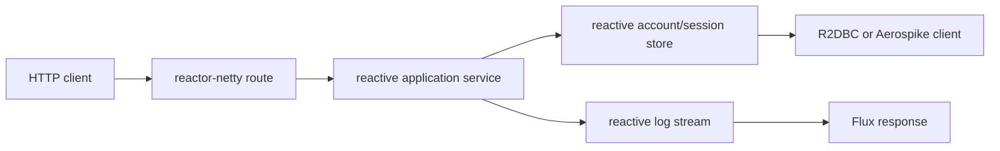

# P-027 · E391 — Reactive showcase — specification

**Issue:** internal work item 391
**Status:** Proposed
**Date:** 2026-08-12
**Parent:** P-027 Reactive / Non-Blocking Appbase (internal work item 277)

## 1. Purpose and boundary

This epic delivers one small, runnable, end-to-end example of Appbase's reactive face. It proves and
teaches this path:

It is a showcase, not a release gate and not a replacement for the exhaustive stacktest work in P-008.
It must live in the hardened `appbase-stacktest` surface P-008 establishes, so its ordinary execution
detects regressions. It does not re-open the dissolved P-027 umbrella or block unrelated work.

The showcase is deliberately native reactor-netty. It does **not** demonstrate the servlet-async bridge:
that is a separate P-033 artefact with a different adoption story.

## 2. Reader journey

The example exposes one documented endpoint that models a useful application read:

1. A client requests an account/session-scoped activity feed.
2. The reactor-netty route calls a reactive service without blocking or subscribing imperatively.
3. The service obtains the account/session state through an existing reactive store and obtains activity
   records through a reactive source.
4. The response streams records as a `Flux`, preserving cancellation and backpressure to the selected
   source.
5. A missing or unavailable dependency produces the documented HTTP error response; it must not hang,
   silently switch to a blocking implementation, or leak internal details.

The implementation plan selects the exact already-supported backend combination after P-008's inventory
and runtime harness are available. The default target is an R2DBC account store plus a reactive log
source. If that pair cannot be run by the standard stacktest infrastructure, the plan must select an
equally supported pair and record why; inventing a demonstration-only client or backend is out of scope.

## 3. Functional requirements

- The endpoint is runnable through the normal stacktest command and returns a streamed response from a
  real reactive service path, not a mocked controller-only demonstration.
- The path uses existing reactive interfaces (`ReactiveUserAccountStore`, `ReactiveUserSessionStore`,
  `ReactiveLogStore`, or a selected supported equivalent) and no synchronous adapter at the HTTP edge.
- The happy path contains at least two emitted records, so streaming is observable rather than inferred
  from a one-element `Mono` disguised as a `Flux`.
- The service validates the request's required identifier before dispatching to a backend. Invalid input
  receives a stable client error; missing state receives a stable not-found response.
- A downstream failure is bounded and maps to a safe service-unavailable response. Tokens, connection
  data, stack traces, and raw driver errors never reach the client.
- Cancelling the HTTP response cancels the upstream reactive subscription. The suite must prove this
  with a controllable publisher or a backend-observable cancellation signal.
- The scenario's setup, route, data shape, and run command are documented beside the example. A reader
  can explain why the route is non-blocking and when the servlet face remains the better choice.

## 4. Non-blocking contract

"Non-blocking throughout" means that the reactor-netty event loop performs neither blocking I/O nor
waiting on a future for the showcase request. It does not mean every implementation in the repository is
magically non-blocking.

- No `block`, `blockFirst`, `blockLast`, `toIterable`, synchronous client call, or manually managed
  `subscribe` appears in the request path.
- The path is BlockHound-clean from route invocation through response completion.
- The BlockHound test includes an armed negative control: placing a known blocking operation on the
  event-loop scheduler makes the test fail. A green detector that cannot detect a violation is not
  evidence.
- Any consciously offloaded legacy boundary is excluded from this showcase. Its inclusion would prove
  scheduler offload, not native non-blocking I/O.

## 5. Acceptance criteria

1. The documented reactor-netty endpoint completes an HTTP request through a reactive service and at
   least two selected reactive data surfaces.
2. The response is observably streamed, and client cancellation propagates upstream.
3. Invalid input, missing state, and an injected downstream failure have stable, safe HTTP outcomes.
4. The end-to-end path is BlockHound-clean, and the negative-control mutation makes the BlockHound test
   red.
5. The showcase runs as part of the ordinary hardened stacktest suite, rather than a manually invoked
   script.
6. Its short walkthrough enables a new Appbase user to run it and distinguish the reactor-netty face
   from the servlet/bridge path.

## 6. Dependencies and exclusions

**Requires:** P-008 (internal work item 1137) to provide the authoritative stacktest inventory, runnable backend
infrastructure, and standard execution entry point. R3 (internal work item 389) and R4 (internal work item 390) are landed prerequisites
that supply the native reactive surfaces this example consumes.

**Does not require:** the OAuth module, the servlet-async bridge, a new client driver, or a new public
framework SPI. Authentication can be added by a later example once its reactive OAuth surface has landed;
it is not needed to prove this showcase's request-to-backend contract.

**Does not deliver:** a replacement `appbase-examples` hierarchy, a generic tutorial system, exhaustive
module coverage, or a benchmark. P-008 owns the first two testing concerns; P-010 owns the broader User
Guide.

## 7. Risks and decisions

| Risk | Control |
|---|---|
| "Flagship" grows into a new application | One read-only journey, existing modules only, no new SPI or driver. |
| A single result hides a non-streaming implementation | Require at least two emitted records and assert incremental/cancellation behaviour. |
| BlockHound is present but unarmed | Keep a negative control that demonstrably fails on a blocking event-loop operation. |
| P-008's backend inventory changes the chosen pair | Make the pair a plan-time decision constrained to P-008-supported infrastructure; record the evidence. |
| The demo competes with the release gate | It is one standard stacktest arm; P-008's coverage/gate requirements take precedence. |

## 8. Execution approach

- **Workflow:** implementation tasks use TDD: add the failing HTTP/StepVerifier or cancellation test,
  implement the smallest path that turns it green, then refactor only while the test remains green.
  The end-to-end and BlockHound checks are functional acceptance evidence.
- **Search order:** use JDT language-server/semantic navigation when available for Java callers and
  implementations; fall back to `rg`, direct reads, and Git history. Use the P-008 inventory for runtime
  capabilities rather than guessing from dependency declarations.
- **Parallelism:** no multi-agent execution is proposed in this spec. Once approved, independent
  documentation and test-harness tasks may be split only by the implementation plan.
- **Berry:** not used. The bounded design space and ordinary six-lens review provide sufficient evidence
  without a paid judge.
- **Sub-tasking:** the plan should split the vertical slice, non-blocking/resilience proof, stacktest
  integration, and reader walkthrough into separately reviewable leaf tasks.

## 9. Planning exit condition

The implementation plan is ready only when it names the selected real backend pair, the endpoint's
concrete request/response contract, the exact stacktest command, each red-first test, and the negative
control that proves BlockHound enforcement. If P-008 cannot supply a runnable pair, report that as a
blocking dependency on internal work item 391 rather than substituting mocks or a private harness.
